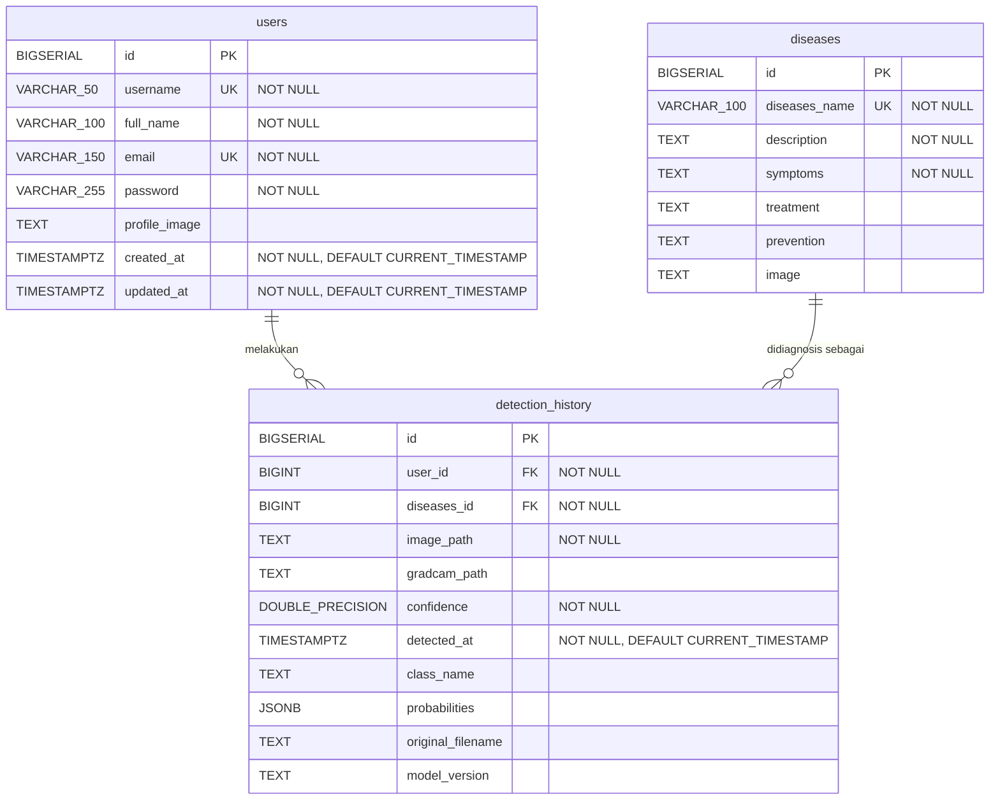

# Entity Relationship Diagram

Diagram relasi tabel berdasarkan file migrasi `001_create_users.sql`, `002_create_disease.sql`, dan `003_create_detection_history.sql`.

## Keterangan Relasi

| Relasi | Kardinalitas | Foreign Key | Aturan Hapus |
|---|---|---|---|
| `users` → `detection_history` | One-to-Many (1 : N) | `detection_history.user_id` → `users.id` | `ON DELETE CASCADE` |
| `diseases` → `detection_history` | One-to-Many (1 : N) | `detection_history.diseases_id` → `diseases.id` | `ON DELETE RESTRICT` |

- Satu **user** dapat memiliki banyak riwayat deteksi. Jika user dihapus, seluruh riwayat deteksinya ikut terhapus (`CASCADE`).
- Satu **penyakit** dapat muncul pada banyak riwayat deteksi. Penyakit tidak dapat dihapus selama masih direferensikan oleh riwayat deteksi (`RESTRICT`).
- `detection_history` adalah tabel penghubung antara `users` dan `diseases`.
