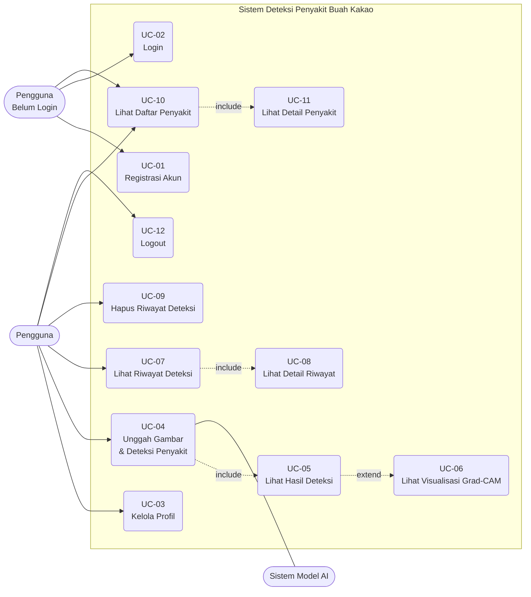

# Use Case

Dokumen use case sistem deteksi penyakit buah kakao, disusun berdasarkan `Erd.md` dan file migrasi `001_create_users.sql`, `002_create_disease.sql`, dan `003_create_detection_history.sql`.

## 1. Aktor

| Aktor | Deskripsi |
|---|---|
| **Pengguna** | Pengguna terdaftar (tabel `users`) yang mengunggah gambar buah kakao dan melihat hasil serta riwayat deteksi. |
| **Pengguna Belum Login** | Pengunjung yang belum memiliki akun atau belum masuk ke sistem. |
| **Sistem Model AI** | Komponen sistem yang mengklasifikasikan gambar, menghasilkan nilai confidence, probabilitas tiap kelas, dan visualisasi Grad-CAM. |

> Catatan: skema database tidak memiliki kolom role, sehingga tidak ada aktor Admin. Data penyakit pada tabel `diseases` diisi melalui seed data pada migrasi.

## 2. Diagram Use Case

## 3. Daftar Use Case

| ID | Nama | Aktor | Tabel Terkait |
|---|---|---|---|
| UC-01 | Registrasi Akun | Pengguna Belum Login | `users` |
| UC-02 | Login | Pengguna Belum Login | `users` |
| UC-03 | Kelola Profil | Pengguna | `users` |
| UC-04 | Unggah Gambar & Deteksi Penyakit | Pengguna, Sistem Model AI | `detection_history`, `diseases` |
| UC-05 | Lihat Hasil Deteksi | Pengguna | `detection_history`, `diseases` |
| UC-06 | Lihat Visualisasi Grad-CAM | Pengguna | `detection_history` |
| UC-07 | Lihat Riwayat Deteksi | Pengguna | `detection_history`, `diseases` |
| UC-08 | Lihat Detail Riwayat | Pengguna | `detection_history`, `diseases` |
| UC-09 | Hapus Riwayat Deteksi | Pengguna | `detection_history` |
| UC-10 | Lihat Daftar Penyakit | Pengguna, Pengguna Belum Login | `diseases` |
| UC-11 | Lihat Detail Penyakit | Pengguna, Pengguna Belum Login | `diseases` |
| UC-12 | Logout | Pengguna | - |

## 4. Skenario Use Case

### UC-01: Registrasi Akun

| Item | Keterangan |
|---|---|
| Aktor | Pengguna Belum Login |
| Prakondisi | Pengguna belum memiliki akun. |
| Pascakondisi | Data akun baru tersimpan di tabel `users`. |

**Alur utama:**
1. Pengguna membuka halaman registrasi.
2. Pengguna mengisi `username`, `full_name`, `email`, dan `password`.
3. Sistem memvalidasi data dan memastikan `username` serta `email` belum digunakan (bersifat `UNIQUE`).
4. Sistem menyimpan password dalam bentuk hash, lalu mencatat `created_at` dan `updated_at`.
5. Sistem menampilkan pesan registrasi berhasil.

**Alur alternatif:**
- 3a. `username` atau `email` sudah terdaftar, sistem menampilkan pesan kesalahan.
- 3b. Data tidak valid atau melebihi batas panjang kolom, sistem meminta pengguna memperbaiki isian.

---

### UC-02: Login

| Item | Keterangan |
|---|---|
| Aktor | Pengguna Belum Login |
| Prakondisi | Pengguna sudah memiliki akun. |
| Pascakondisi | Pengguna masuk dan memperoleh sesi/token autentikasi. |

**Alur utama:**
1. Pengguna memasukkan `username` atau `email` dan `password`.
2. Sistem mencocokkan kredensial dengan data di tabel `users`.
3. Sistem membuat sesi/token dan mengarahkan pengguna ke halaman utama.

**Alur alternatif:**
- 2a. Kredensial salah, sistem menampilkan pesan kesalahan.

---

### UC-03: Kelola Profil

| Item | Keterangan |
|---|---|
| Aktor | Pengguna |
| Prakondisi | Pengguna sudah login. |
| Pascakondisi | Data profil diperbarui dan `updated_at` ikut diperbarui. |

**Alur utama:**
1. Pengguna membuka halaman profil.
2. Sistem menampilkan `username`, `full_name`, `email`, dan `profile_image`.
3. Pengguna mengubah `full_name`, `email`, `password`, atau `profile_image`.
4. Sistem memvalidasi dan menyimpan perubahan.

**Alur alternatif:**
- 4a. `email` baru sudah digunakan akun lain, sistem menolak perubahan.

---

### UC-04: Unggah Gambar & Deteksi Penyakit

| Item | Keterangan |
|---|---|
| Aktor | Pengguna, Sistem Model AI |
| Prakondisi | Pengguna sudah login dan memiliki gambar buah kakao. |
| Pascakondisi | Satu baris baru tersimpan di `detection_history`. |

**Alur utama:**
1. Pengguna memilih dan mengunggah gambar buah kakao.
2. Sistem menyimpan gambar dan mencatat `image_path` serta `original_filename`.
3. Sistem mengirim gambar ke Sistem Model AI.
4. Model AI mengklasifikasikan gambar dan mengembalikan `class_name`, `confidence`, `probabilities`, serta citra Grad-CAM.
5. Sistem mencocokkan `class_name` dengan `diseases.diseases_name` untuk memperoleh `diseases_id`.
6. Sistem menyimpan hasil ke `detection_history` (`user_id`, `diseases_id`, `image_path`, `gradcam_path`, `confidence`, `class_name`, `probabilities`, `original_filename`, `model_version`, `detected_at`).
7. Sistem menampilkan hasil deteksi (UC-05).

**Alur alternatif:**
- 1a. Format atau ukuran file tidak didukung, sistem menolak unggahan.
- 4a. Model AI gagal memproses gambar, sistem menampilkan pesan kesalahan dan tidak menyimpan riwayat.
- 5a. Kelas hasil prediksi tidak ditemukan di tabel `diseases`, sistem menampilkan pesan kesalahan.

---

### UC-05: Lihat Hasil Deteksi

| Item | Keterangan |
|---|---|
| Aktor | Pengguna |
| Prakondisi | Deteksi telah selesai dilakukan (UC-04). |
| Pascakondisi | Pengguna mengetahui hasil deteksi dan informasi penyakitnya. |

**Alur utama:**
1. Sistem menampilkan gambar yang diunggah, nama penyakit, dan nilai `confidence`.
2. Sistem menampilkan distribusi `probabilities` untuk setiap kelas.
3. Sistem menampilkan informasi dari tabel `diseases`: deskripsi, gejala, penanganan, dan pencegahan.

---

### UC-06: Lihat Visualisasi Grad-CAM

| Item | Keterangan |
|---|---|
| Aktor | Pengguna |
| Prakondisi | Hasil deteksi memiliki `gradcam_path`. |
| Pascakondisi | Pengguna melihat area gambar yang memengaruhi prediksi model. |

**Alur utama:**
1. Pengguna memilih opsi tampilkan Grad-CAM pada hasil deteksi.
2. Sistem menampilkan gambar Grad-CAM dari `gradcam_path`.

**Alur alternatif:**
- 1a. `gradcam_path` kosong (kolom bersifat opsional), sistem menampilkan pesan bahwa visualisasi tidak tersedia.

---

### UC-07: Lihat Riwayat Deteksi

| Item | Keterangan |
|---|---|
| Aktor | Pengguna |
| Prakondisi | Pengguna sudah login. |
| Pascakondisi | Daftar riwayat milik pengguna ditampilkan. |

**Alur utama:**
1. Pengguna membuka halaman riwayat.
2. Sistem mengambil data `detection_history` berdasarkan `user_id` pengguna, digabung dengan `diseases`.
3. Sistem menampilkan daftar berurutan dari `detected_at` terbaru: gambar, nama penyakit, `confidence`, dan waktu deteksi.

**Alur alternatif:**
- 2a. Belum ada riwayat, sistem menampilkan pesan bahwa riwayat masih kosong.

---

### UC-08: Lihat Detail Riwayat

| Item | Keterangan |
|---|---|
| Aktor | Pengguna |
| Prakondisi | Pengguna memiliki minimal satu riwayat deteksi. |
| Pascakondisi | Detail satu riwayat ditampilkan. |

**Alur utama:**
1. Pengguna memilih salah satu riwayat.
2. Sistem menampilkan gambar asli, Grad-CAM, `confidence`, `probabilities`, `model_version`, `original_filename`, dan informasi penyakit.

**Alur alternatif:**
- 1a. Riwayat bukan milik pengguna yang sedang login, sistem menolak akses.

---

### UC-09: Hapus Riwayat Deteksi

| Item | Keterangan |
|---|---|
| Aktor | Pengguna |
| Prakondisi | Pengguna memiliki riwayat deteksi. |
| Pascakondisi | Baris `detection_history` terkait terhapus. |

**Alur utama:**
1. Pengguna memilih riwayat yang akan dihapus.
2. Sistem meminta konfirmasi.
3. Pengguna mengonfirmasi.
4. Sistem menghapus data riwayat (dan file gambar terkait bila diperlukan).
5. Sistem menampilkan pesan berhasil.

**Alur alternatif:**
- 3a. Pengguna membatalkan, tidak ada data yang dihapus.

---

### UC-10: Lihat Daftar Penyakit

| Item | Keterangan |
|---|---|
| Aktor | Pengguna, Pengguna Belum Login |
| Prakondisi | - |
| Pascakondisi | Daftar penyakit dan kondisi buah kakao ditampilkan. |

**Alur utama:**
1. Aktor membuka halaman informasi penyakit.
2. Sistem mengambil data dari tabel `diseases`.
3. Sistem menampilkan daftar: Busuk Buah, Helopeltis, Penggerek Buah Kakao, dan Kakao Sehat, lengkap dengan gambar (`image`).

---

### UC-11: Lihat Detail Penyakit

| Item | Keterangan |
|---|---|
| Aktor | Pengguna, Pengguna Belum Login |
| Prakondisi | Daftar penyakit ditampilkan. |
| Pascakondisi | Informasi lengkap satu penyakit ditampilkan. |

**Alur utama:**
1. Aktor memilih salah satu penyakit.
2. Sistem menampilkan `description`, `symptoms`, `treatment`, `prevention`, dan `image`.

---

### UC-12: Logout

| Item | Keterangan |
|---|---|
| Aktor | Pengguna |
| Prakondisi | Pengguna sudah login. |
| Pascakondisi | Sesi/token pengguna tidak berlaku lagi. |

**Alur utama:**
1. Pengguna memilih logout.
2. Sistem mengakhiri sesi dan mengarahkan pengguna ke halaman login.

## 5. Aturan Bisnis dari Skema Database

| Aturan | Sumber |
|---|---|
| `username` dan `email` harus unik. | `users` (`UNIQUE`) |
| Nama penyakit harus unik. | `diseases.diseases_name` (`UNIQUE`) |
| Setiap deteksi wajib terkait dengan satu pengguna dan satu penyakit. | FK `user_id` dan `diseases_id` (`NOT NULL`) |
| Jika akun pengguna dihapus, seluruh riwayat deteksinya ikut terhapus. | `ON DELETE CASCADE` |
| Penyakit yang masih dipakai oleh riwayat deteksi tidak dapat dihapus. | `ON DELETE RESTRICT` |
| Gambar dan nilai `confidence` wajib ada pada setiap deteksi, sedangkan Grad-CAM bersifat opsional. | `image_path`, `confidence` (`NOT NULL`), `gradcam_path` (nullable) |
| Waktu deteksi dicatat otomatis. | `detected_at DEFAULT CURRENT_TIMESTAMP` |
